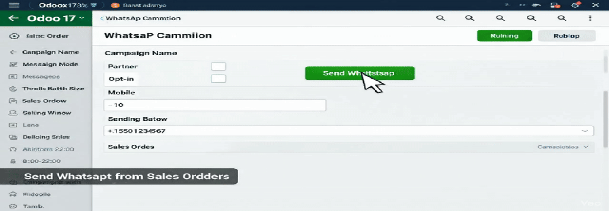
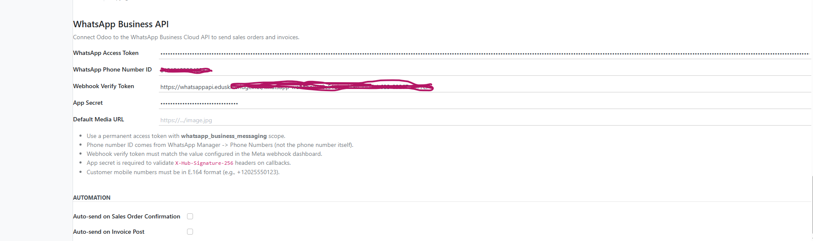
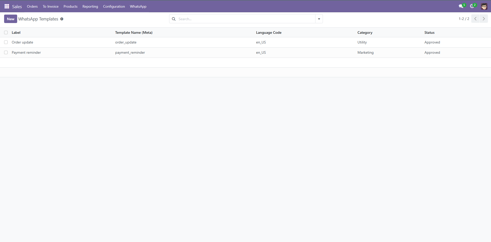
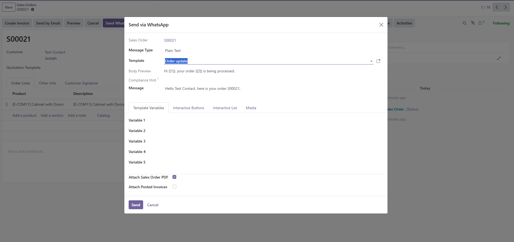
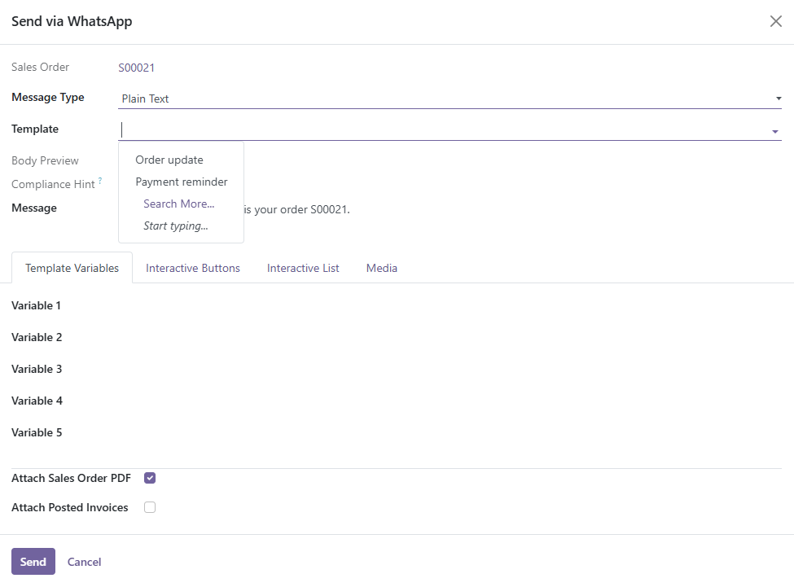
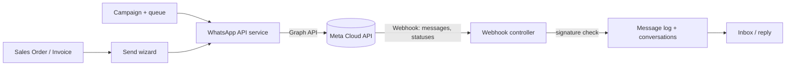

# WhatsApp Cloud Messaging for Odoo


An Odoo module that connects Sales and Accounting to the official **Meta WhatsApp Business Cloud API**. Send orders and invoices, reply to customers from an inbox inside Odoo, and run opt-in compliant bulk campaigns with delivery and read tracking.

Published on the Odoo Apps Store:
[Odoo 18](https://apps.odoo.com/apps/modules/18.0/skillbridge_whatsapp_cloud) ·
[Odoo 17](https://apps.odoo.com/apps/modules/17.0/skillbridge_whatsapp_cloud)



## Features

- **Send from Odoo records:** WhatsApp messages from Sales Orders and posted invoices, with PDF attachments
- **Message types:** plain text, approved Meta templates, images, and interactive buttons and lists
- **Inbox:** reply to inbound messages and see the full conversation history per customer
- **Template sync:** pull templates from your WhatsApp Business Account so names, statuses and languages stay aligned
- **Campaigns:** bulk sending with queues, throttling, drip steps, retries with backoff, and KPI dashboards
- **Compliance:** partner opt-in flags, E.164 phone validation, and automatic STOP / START keyword handling
- **Multi-company:** one WhatsApp account per company, with tokens stored in Odoo instead of hard-coded
- **Secure webhooks:** verify-token handshake and app-secret signature validation, with delivery, read and failure logs

## Screenshots

| Inbox | Campaigns |
|---|---|
|  |  |
| **Templates** | **Analytics** |
|  |  |

## How it works



## Supported Odoo versions

Each Odoo version lives on its own branch, which is what gets published to the Apps Store:

| Odoo | Branch |
|---|---|
| 19.0 | [`19.0`](../../tree/19.0) |
| 18.0 | [`18.0`](../../tree/18.0) |
| 17.0 | [`17.0`](../../tree/17.0) |
| 16.0 | [`16.0`](../../tree/16.0) |
| 15.0 | [`15.0`](../../tree/15.0) |

## Requirements

- A WhatsApp Business Cloud API app in Meta for Developers
- A permanent access token with the `whatsapp_business_messaging` scope (plus `whatsapp_business_management` for template sync)
- Phone number ID and WhatsApp Business Account (WABA) ID
- A webhook verify token and your app secret
- Python package: `requests`

## Installation

1. Check out the branch that matches your Odoo version and copy `skillbridge_whatsapp_cloud/` into your addons path, or install it from the Odoo Apps Store.
2. Restart Odoo, update the Apps list, and install **WhatsApp Cloud Messaging**.
3. Go to **Settings → WhatsApp Business API** and enter the token, phone number ID, WABA ID, verify token and app secret.
4. Point your Meta webhook at your Odoo instance and subscribe to `messages`.
5. Approve templates in Meta, sync them into Odoo, then send from a Sales Order or start a campaign.

## Running the tests

The module ships with tests for settings validation, webhook signature checks, and webhook processing:

```bash
odoo-bin -d test_db -i skillbridge_whatsapp_cloud --test-tags /skillbridge_whatsapp_cloud --stop-after-init
```

## Project layout

```
skillbridge_whatsapp_cloud/
├── controllers/   # Webhook endpoint (verification + signed event processing)
├── models/        # Accounts, templates, campaigns, queues, conversations, logs, API client
├── views/         # Inbox, campaigns, templates, logs, settings, wizards
├── security/      # Access rights and record rules
├── data/          # Scheduled actions (campaign queue processing)
└── tests/         # Unit tests
```

## Changelog

See [`CHANGELOG.md`](skillbridge_whatsapp_cloud/CHANGELOG.md).

## License

Odoo Proprietary License v1.0 (OPL-1). See [`LICENSE`](skillbridge_whatsapp_cloud/LICENSE).

## Author

Built by [Ayman Osman](https://github.com/coldworld22). Support: support@eduskillbridge.net
